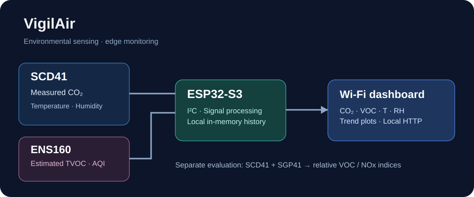

# VigilAir

**Indoor air quality sensing · embedded monitoring · environmental data analysis**

VigilAir is an independently developed, evolving sensor-fusion project exploring how reliable CO₂ measurements and complementary gas-sensor signals can support meaningful indoor-air decisions. The work spans sensor integration, embedded firmware, environmental compensation, web dashboards and analysis of measurement histories.



> The architecture illustration is schematic. The historical dashboard capture (VigilAir v3.2, SCD41 + ENS160) is available in the accompanying [public starter package](https://github.com/fernando-parodi/vigilair) for later binary upload. The image is **not** evidence of a released Sensirion SGP41 product.

## Two developed configurations

| Track | Sensors | Measurement meaning | Available development evidence |
| --- | --- | --- | --- |
| Embedded Wi-Fi prototype | Sensirion **SCD41** + ScioSense **ENS160** | Measured CO₂ (ppm), SCD41 temperature/RH, ENS160 estimated TVOC (ppb) and vendor AQI category | Recovered ESP32-S3 v2/v3 firmware, AP dashboard with local trend plots, CRC-checked SCD41 packets |
| **Sensirion Pro** evaluation | Sensirion **SCD41** + **SGP41** | Measured CO₂ (ppm); temperature/RH; SGP41 raw VOC/NOx signals and relative VOC/NOx indices | Historical ~5-second logged evaluation: reported 17,279-row, ~24-hour trace and exploratory event analysis |

**SGP41 VOC/NOx Index is not gas concentration in ppb; ENS160 eCO₂ is not a direct CO₂ measurement.** See [measurement semantics](docs/measurement-semantics.md).

## Contents of this public portfolio edition

- An overview of the sensor architecture, separated by proven development tracks.
- A real historical **SCD4x CRC-8 routine**, extracted from the older ESP32 dashboard firmware and isolated with a host-compiled regression test.
- A dependency-free **public CSV diagnostics example** and **explicitly synthetic** test data. This is not the private production analytics system.
- Historical validation notes, with evidence limitations stated clearly.
- A milestone-based roadmap.

Full embedded firmware, production device configuration, proprietary alarm or decision logic, private measurement archives, infrastructure, and other commercial implementation details are **not included**.

## Explore the engineering

| Document | Focus |
| --- | --- |
| [Architecture](docs/architecture.md) | Dual-sensor embedded device, local dashboard, Sensirion Pro historian concept |
| [Measurement semantics](docs/measurement-semantics.md) | Distinguishing measured CO₂, eCO₂, estimated TVOC and VOC/NOx index |
| [Validation notes](docs/validation.md) | Historical observations, datasets and evidence limits |
| [Public roadmap](docs/roadmap.md) | Version-by-version development |
| [Runnable code examples](examples/README.md) | CRC test and CSV diagnostics |

## Run the public examples

C++ CRC-8 regression test (standard compiler):

```bash
g++ -std=c++17 -Wall -Wextra -Werror -pedantic examples/test_scd4x_crc8.cpp -o /tmp/vigilair_crc_test
/tmp/vigilair_crc_test
```

CSV diagnostics (Python 3.9+ standard library):

```bash
python3 examples/analysis/csv_report.py examples/analysis/sample_synthetic.csv
python3 -m unittest discover -s tests -v
```

The bundled CSV is **synthetic**; it is not a recorded observation from VigilAir hardware.

## Boundaries and safety

This is a research-and-engineering portfolio, **not** a certified indoor-air-quality instrument, life-safety alarm, occupational exposure measurement system, or substitute for calibrated reference equipment. Do not rely on these examples for emergency detection or safety-critical control.

## Author and rights

**Fernando Parodi** · [GitHub](https://github.com/fernando-parodi)

Published as a technical portfolio and educational reference. No open-source license is granted unless explicitly stated; **all rights reserved**. No rights to the unpublished device firmware or commercial implementation are granted. Contact the author for permission to reuse or collaborate.

Public repository release numbers (starting with **v0.1.0**) are distinct from historical internal firmware names such as **VigilAir v3.2**.
